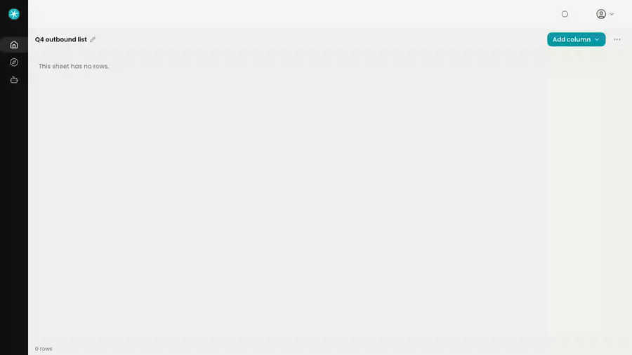
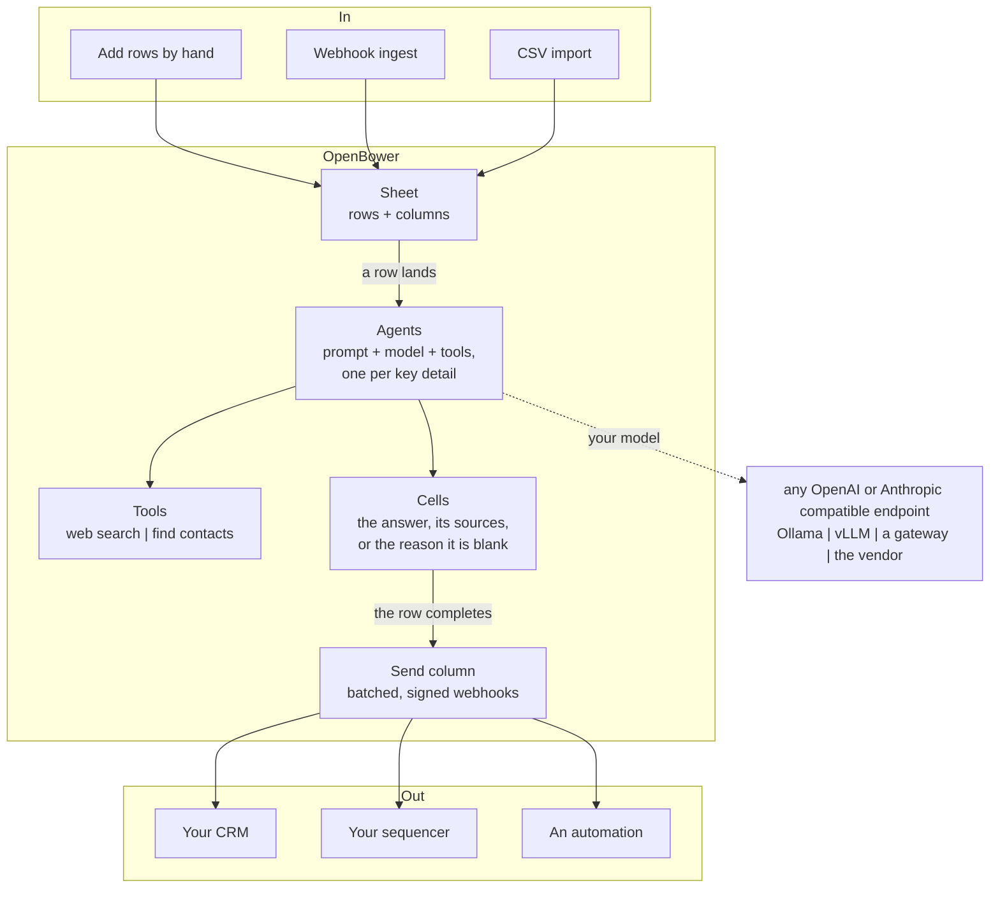

<p align="center">
  
</p>

<p align="center">
  Open-source sales intelligence
</p>

<p align="center">
  <a href="LICENSE"></a>
</p>

<p align="center">
  <b><a href="https://openbower.ai/">openbower.ai</a></b> |
  <a href="#quickstart">Quickstart</a> |
  <a href="#how-it-works">How it works</a> |
  <a href="CHANGELOG.md">Changelog</a> |
  <a href="CONTRIBUTING.md">Contributing</a>
</p>

---

> [!TIP]
> **Don't want to run it yourself?** A hosted version is on the way: join the waitlist at [openbower.ai](https://openbower.ai/). Or run it on your own machine with one command, see [Quickstart](#quickstart).

## What it does

OpenBower is an open-source, self-hostable Clay alternative. Build agentic GTM workflows that turn raw signals into researched rows.

<p align="center">
  
</p>

**Key capabilities**

- **Signals in.** Rows arrive by hand, by webhook, or from a CSV, and every arrival kicks off the necessary agents the moment it lands.
- **An agent per detail.** Build an agent once (a prompt, a model, the tools it may use) and reuse it on every sheet.
- **Get notified.** A Send column waits for the required work to finish, then notifies you or syncs completed rows to your CRM, sequencer, or automation over signed webhooks.
- **Bring your own model.** Any OpenAI or Anthropic compatible endpoint, including one on your laptop, so the whole pipeline runs for $0 while you prove your idea.
- **Self-host free, or hosted.** Run it on your own machine forever, or [join the waitlist](https://openbower.ai/) for the hosted version.
- **Everything before hello, automated.** A row lands, the agents research it, the finished row reaches your sequencer. The conversation is yours.

## Why OpenBower

- **Built for builders.** Closed tools are built for venture-backed startups and organizations past product-market fit, so they price heavily to get started. If you can run code and have the compute, you should be able to run the tools yourself, at cost. That is what OpenBower is for: arming founders with tools they can run at cost while they find fit, and offering a managed version to graduate to when it is time to scale.
- **Orchestration is not inference.** Platforms resell vendor models at a markup. Here the coordination runs on your compute and the model costs what the vendor charges, or nothing when it's a model you run.
- **Plug in anything.** Closed tools give everyone the same data sources, so every outreach starts from the same foundation. Here you can plug in any information source as a tool or as a signal that starts your workflow. Standing out is what closes deals.

## Quickstart

On macOS or Linux with Docker (Compose v2.24 or newer) running:

```bash
curl -fsSL https://openbower.ai | sh
```

The install clones the newest release into a directory you choose, checks the prerequisites (and says how to get any that are missing), builds and starts the stack, walks you through pointing it at a model, and puts one command on your PATH: `bower-admin`. Then open http://localhost:3003. (Prefer to clone first? `git clone https://github.com/obris-dev/openbower.git && cd openbower && sh scripts/bower-admin.sh install` is the same flow.)

`bower-admin` is how you operate the install (there is no separate `bower` CLI yet):

| Command | Does |
|---------|------|
| `bower-admin up` / `stop` | start the stack, or halt it in place (a running row finishes first) |
| `bower-admin logs [service]` | tail every service, or one (`core`, `jobs`, `fill-consumer`, `web`) |
| `bower-admin status` | what is running |
| `bower-admin setup` | probe your inference sources, and add one when none answers |
| `bower-admin upgrade` | move to the newest release and rebuild; your data stays |
| `bower-admin help` | everything else |

The install seeds `apps/core/.env` (with its own secret), `config/providers.toml` and `config/tools.toml` from their templates and never overwrites them afterwards. It serves the app on http://localhost:3003, the marketing site on http://localhost:3004, and the API on :8002. The containers bind-mount the checkout, so an edit hot-reloads without a rebuild. Every service in the stack, and the environment facts a deploy needs, are in [DEPLOY.md](DEPLOY.md); developing on the repo itself goes through `make` (see [CONTRIBUTING.md](CONTRIBUTING.md)).

> [!NOTE]
> **Signing in uses the hosted account hub, out of the box.** Accounts live at auth.openbower.ai; your install is an OAuth client of it, and the similar-companies feature reads the hosted company universe at data.openbower.ai with your account's token. A fresh install points at both already: sign up or sign in from your own install's login page. Nothing else needs deploying, and everything but the login itself and that one lookup runs on your machine; an install keeps working through a hub outage for everyone already signed in. The repo-root `.env` the install seeds carries a commented block for pointing the stack at locally run development copies of those two services instead, which only someone developing the hub itself needs. A self-host reached on its own domain rather than localhost is on the roadmap: it needs its callback registered at the hub.

### Prereq: a model

OpenBower is bring-your-own-model; the stack does not bundle one. Inference sources (their structure and their keys) live in one file, `config/providers.toml`, seeded from `config/templates/providers.example.toml`. The template ships no live source; the install's setup step probes what is there and offers to add one when none answers; `bower-admin setup` runs that again any time, `bower-admin providers` prints what each source serves, and `bower-admin reload` applies a hand edit. A section names a registered provider spec, and any source that speaks it is a first-class entry:

- **On your laptop.** Install [Ollama](https://ollama.com/download), then `ollama pull gemma4:12b && ollama serve`; setup's first option defaults to its endpoint (reached from the containers at `http://host.docker.internal:11434/v1`), and you pick the model in the agent builder.
- **Your own deployment.** A vLLM box, a gateway, or any server that speaks the OpenAI or Anthropic protocol: add a section with its `base_url`. Self-hosted servers work keyless.
- **The vendor itself.** OpenAI or Anthropic, with an `api_key` inline; the canonical vendors stay out of the catalog until a key is present.

A typo'd section refuses startup with the section named, so a broken config never runs silently.

### Prereq: search vendors

Tool vendors and their wiring live in `config/tools.toml`, seeded from its template. The install's setup step asks for a [Serper](https://serper.dev) key (a free account starts with 2,500 queries), checks it with one query, writes it, and wires web search to it, which is the setup the product works well with: real Google results for web search, and the only vendor for finding contacts. Without a key, web search falls back to DuckDuckGo (free, keyless, weaker results) and finding contacts stays off; `bower-admin setup` asks again any time. On the free door a fill is budgeted: one whose search count would exceed the budget is refused before it spends, naming the metered next step. `bower-admin tools` prints the live matrix.

### Use it

Open the app, create a sheet (or import a CSV), configure your agentic columns, then start adding rows. Each row's details land as its research completes, and a Send column syncs finished rows wherever you send from.

## How it works



1. New rows land on a sheet, by hand, by webhook, or from a CSV.
2. Agentic workflows run as the rows land, adding the details that matter for your GTM play.
3. As the details land, the results sync to your CRM, sequencer, or automation, or you get notified, so you act in real time instead of checking the sheet.

## Roadmap

Today the engine runs on signals you source yourself: a row you add, a webhook you wired, a CSV you had. Next, the common signals come built in: a fundraise, a leadership change, a hiring spike, a job post, a product launch. Nothing to wire; each one lands as a row and notifies you when its research is ready. The moment something relevant happens, it reaches you first, so you're in front of the right person while it still matters.

Which signal would start a play for you? Open an issue and say.

## Hosted version

Self-hosting is free and stays free. A hosted version (we run the engine for you: always on, listening for your GTM signals) is in the works as the paid tier, a hosting fee rather than credits.

Join the waitlist at [openbower.ai](https://openbower.ai/).

## Documentation

- [CONTRIBUTING.md](CONTRIBUTING.md): contribution flow, branch naming, running the checks.
- [CHANGELOG.md](CHANGELOG.md): notable changes per release.
- [DEPLOY.md](DEPLOY.md): the self-host footprint, service by service, and the environment it needs.
- [SECURITY.md](SECURITY.md): reporting a vulnerability.
- [AGENTS.md](AGENTS.md): the design conventions, plus the web workspace's own in [web/AGENTS.md](web/AGENTS.md).

<!-- PLACEHOLDER: Community (Discussions, the pinned signals thread) once the repo is public. -->

## License

OpenBower is open source under the [Apache License 2.0](LICENSE), with additional terms reserving an optional `ee/` directory for future commercial features.
