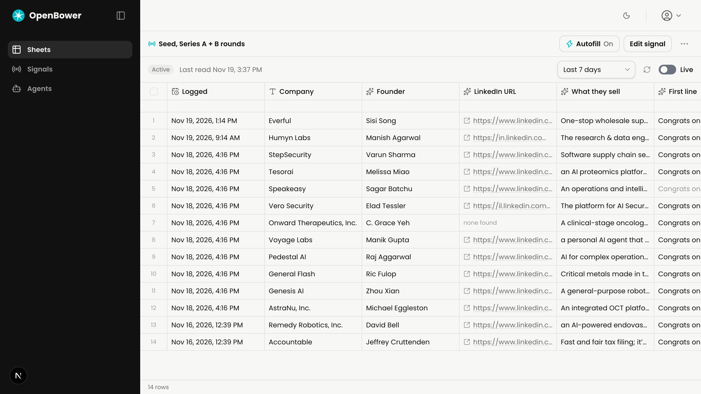
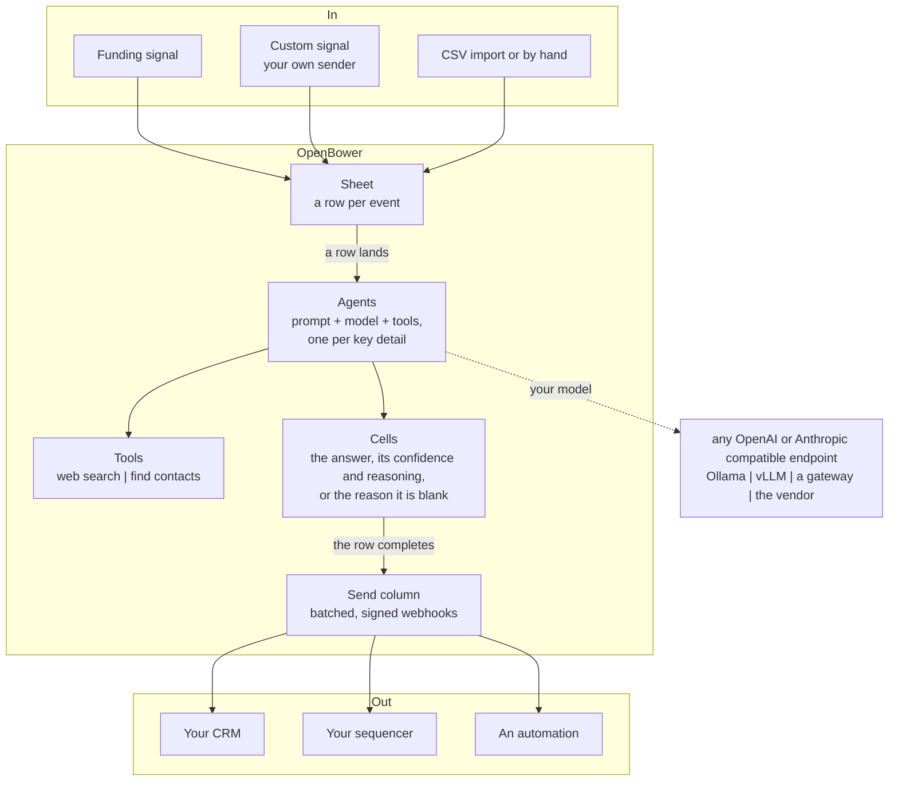
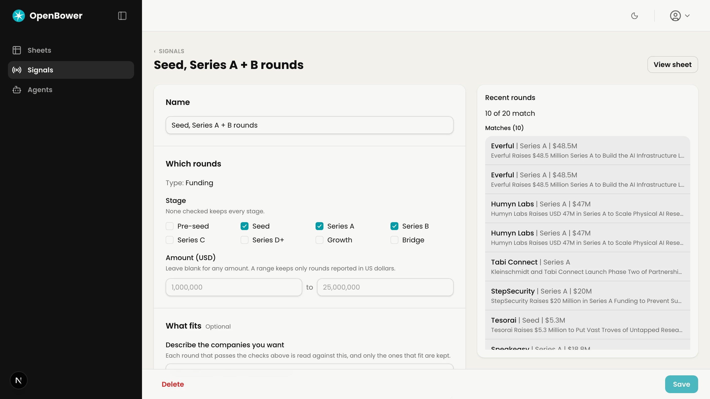
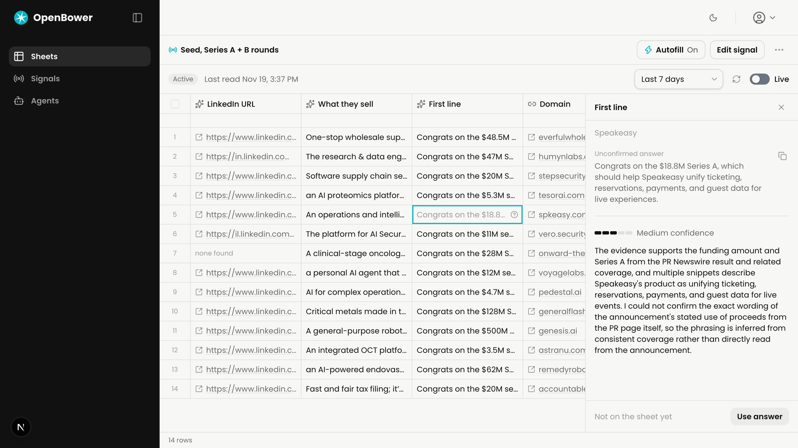
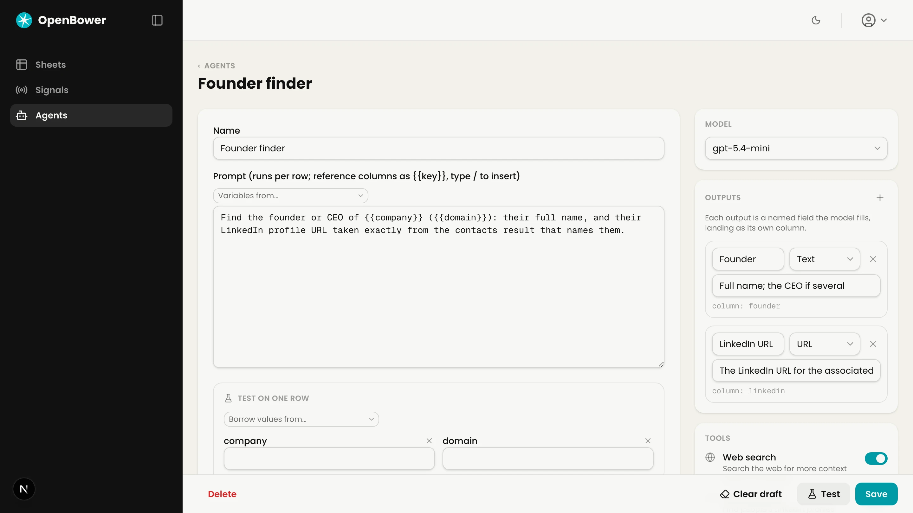

<p align="center">
  
</p>

<p align="center">
  <b>Open-source, self-hostable Clay alternative</b>
</p>

<p align="center">
  <a href="LICENSE"></a>
</p>

<p align="center">
  <b><a href="https://openbower.ai/">openbower.ai</a></b> |
  <a href="#quickstart">Quickstart</a> |
  <a href="#features">Features</a> |
  <a href="CHANGELOG.md">Changelog</a> |
  <a href="CONTRIBUTING.md">Contributing</a>
</p>

<p>
  <a href="https://openbower.ai/">
    
  </a>
</p>

OpenBower is the GTM orchestration layer you control. If Clay's credits are too expensive or its workflows too complex, self-host OpenBower and run your workflows at cost.

> [!TIP]
> **Don't want to run it yourself?** A hosted version is on the way: join the waitlist at [openbower.ai](https://openbower.ai/). Or run it on your own machine with one command, see [Quickstart](#quickstart).

## Quickstart

On macOS or Linux with Docker (Compose v2.24 or newer) running:

```bash
curl -fsSL https://openbower.ai | sh
```

Prefer to run it yourself?

```bash
git clone https://github.com/obris-dev/openbower.git && cd openbower && sh scripts/bower-admin.sh install
```

`bower-admin` is how you operate the install:

| Command | Does |
|---------|------|
| `bower-admin up` / `stop` | start the stack, or halt it in place (a running row finishes first) |
| `bower-admin logs [service]` | tail every service, or one (`core`, `jobs`, `fill-consumer`, `web`) |
| `bower-admin status` | what is running |
| `bower-admin setup` | configure where models run, and the search vendor |
| `bower-admin upgrade` | move to the newest release and rebuild |
| `bower-admin help` | everything else |

> [!NOTE]
> **Signing in uses the hosted account hub, out of the box.** Sign in on your install sends the browser to the hub's login page at app.openbower.ai and back to your install, signed in. The same account unlocks the built-in data sources, such as the similar-companies source.

### Prereq: a model

OpenBower doesn't bundle a model; bring any OpenAI or Anthropic compatible one. Models are set in `config/providers.toml`, and `bower-admin setup` walks you through it:

- **On your laptop.** Install [Ollama](https://ollama.com/download) or [vLLM](https://docs.vllm.ai/en/latest/getting_started/quickstart/#installation), then run `bower-admin setup` to point the stack at it.
- **Your own deployment.** A vLLM box, a gateway, or any server that speaks the OpenAI or Anthropic protocol: add a section with its `base_url`. Self-hosted servers need no key.
- **The vendor itself.** OpenAI or Anthropic, with an `api_key`.

### Prereq: search vendors

Search vendors live in `config/tools.toml`, seeded from its template. The install's setup step asks for a [Serper](https://serper.dev) key (a free account starts with 2,500 queries) and wires web search and finding contacts to it. Without a key, web search falls back to DuckDuckGo (free, keyless, weaker results) and finding contacts stays off; `bower-admin setup` asks again any time.

### Use it

Open the app and create a signal: a funding signal for rounds that fit, or a custom signal your own sender pushes to. Each signal logs its events to a sheet. Add agent columns to it, and every new row is researched as it lands. Add a Send webhook column to sync finished rows to your CRM, sequencer, or automation.

## Features

- **Funding signals.** Rounds that fit your stages, amounts and description, logged as they're announced.
- **Custom signals.** Push your own events by webhook; each lands as a typed row.
- **Answers you can check.** Every answer carries its confidence and reasoning; low-confidence ones wait for you.
- **Send to your CRM.** Finished rows sync to your CRM, sequencer, or automation over signed webhooks; your CRM stays the record.
- **Agents.** A prompt, a model, its tools and outputs, built once and reused on every sheet.
- **Bring your own model.** Any OpenAI or Anthropic compatible endpoint, including one on your laptop.
- **Self-host free.** Forever, or [join the waitlist](https://openbower.ai/) for the hosted version.

## Why OpenBower

- **Built for builders.** Closed tools are built for venture-backed startups and organizations past product-market fit, so they price heavily to get started. If you can run code and have the compute, you should be able to run the tools yourself, at cost. That is what OpenBower is for: arming founders with tools they can run at cost while they find fit, and offering a managed version to graduate to when it is time to scale.
- **Orchestration is not inference.** Platforms resell vendor models at a markup. Here the coordination runs on your compute and the model costs what the vendor charges, or nothing when it's a model you run.
- **Plug in anything.** Closed tools give everyone the same data sources, so every outreach starts from the same foundation. Here you can plug in any information source as a tool or as a signal that starts your workflow. Standing out is what closes deals.

## How it works



1. A signal logs each event that fits as a row on its sheet. Rows can also come from a CSV or be added by hand.
2. Agents run as the rows land, adding the details that matter for your GTM play.
3. As a row completes, a Send column syncs it to your CRM, sequencer, or automation, so you act in real time instead of checking the sheet.

## Screenshots

<p>
  
</p>
<p>
  
</p>
<p>
  
</p>

## Roadmap

Funding is the first built-in signal. Next come more of the common ones: a leadership change, a hiring spike, a job post, a product launch. Nothing to wire; each one lands as a row and its research is ready the moment it matters, so you're in front of the right person first.

Which signal would start a play for you? Open an issue and say.

## Hosted version

Self-hosting is free and stays free. A hosted version (we run the engine for you: always on, listening for your GTM signals) is in the works as the paid tier, a hosting fee rather than credits.

Join the waitlist at [openbower.ai](https://openbower.ai/).

## Documentation

- [CONTRIBUTING.md](CONTRIBUTING.md): contribution flow, branch naming, running the checks.
- [CHANGELOG.md](CHANGELOG.md): notable changes per release.
- [DEPLOY.md](DEPLOY.md): the self-host footprint, service by service, and the environment it needs.
- [SECURITY.md](SECURITY.md): reporting a vulnerability.
- [AGENTS.md](AGENTS.md): the design conventions, plus the web workspace's own in [web/AGENTS.md](web/AGENTS.md).

<!-- PLACEHOLDER: Community (Discussions, the pinned signals thread) once the repo is public. -->

## License

OpenBower is open source under the [Apache License 2.0](LICENSE), with additional terms reserving an optional `ee/` directory for future commercial features.
